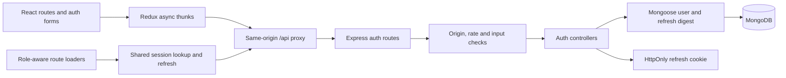

# Jogaar — Role-Based Marketplace

**In active development.** A React and Express marketplace prototype for seekers and service providers. Account/session APIs, role-aware navigation and the authentication interface are implemented and covered by automated regressions. Service listings, search, bookings and functional dashboard/profile tools remain unfinished.

JavaScript · React · Redux Toolkit · React Router · Custom CSS · Node.js · Express · MongoDB · Mongoose · JWT

## Current implementation

| Area | Implemented | Remaining work |
| --- | --- | --- |
| Accounts | Registration, bcrypt hashing, strict role/input validation, duplicate-email conflict handling | Account recovery and email verification |
| Sessions | 15-minute access JWTs, seven-day HttpOnly refresh cookies, hashed refresh storage and atomic rotation | Independent device sessions and a shared rate-limit store for multiple instances |
| Access control | Bearer authentication, current-user/role checks, reusable server role authorization and client guards | Resource ownership checks for future marketplace APIs |
| Interface | Landing page, sign-in/join dialogs, Redux session state, role-specific navigation, themes | Provider tools, editable profiles, marketplace workflows |
| Verification | Server unit/integration tests, client unit/browser tests, lint, production build and GitHub Actions | Production-host and deployment acceptance |

This remains a development project. Passing authentication regressions do not establish production readiness or a completed marketplace. See [status](docs/STATUS.md) and [security boundaries](docs/SECURITY-NOTES.md).

## Start locally

Use **Node.js 24** and npm. Install the two packages separately; this folder is not an npm workspace.

1. Start a local MongoDB instance, or prepare a development database.
2. Prepare the API:

   ```bash
   cd server
   npm ci
   cp .env.example .env
   ```

   Set `MONGO_URI` and generate two independent JWT secrets, each at least 32 bytes. Generate each separately with `node -e "console.log(require('node:crypto').randomBytes(48).toString('hex'))"`. Keep `.env` private.

   ```bash
   npm run dev
   ```

   The default API port is **3000**, configurable with `PORT`. The API starts only after MongoDB connects and the user indexes initialize. `npm start` runs without nodemon.

3. In a second terminal:

   ```bash
   cd real-client
   npm ci
   npm run dev
   ```

   Open Vite's printed URL. Development and preview proxy `/api` to `http://localhost:3000`. Set `JOGAAR_API_TARGET` when using a different API address, for example `JOGAAR_API_TARGET=http://localhost:3001 npm run dev`. This is Vite configuration, not a browser-exposed secret.

### Environment

| Variable | Purpose |
| --- | --- |
| `MONGO_URI` | Backend development database URI |
| `ACCESS_TOKEN_SECRET` | Access signing secret, at least 32 bytes |
| `REFRESH_TOKEN_SECRET` | Different refresh signing secret, at least 32 bytes |
| `PORT` | API listening port; default 3000 |
| `NODE_ENV` | Set to `production` for Secure cookies and production configuration checks |
| `PUBLIC_ORIGIN` | Exact browser origin without a trailing slash; required HTTPS origin in production |
| `JOGAAR_API_TARGET` | Optional Vite dev/preview API proxy target |

For local Vite use, leave `PUBLIC_ORIGIN` empty: the browser Origin is checked against the forwarded Host. A production host needs an HTTPS same-origin `/api` reverse proxy, SPA fallback and a matching `PUBLIC_ORIGIN`. No public deployment is configured or verified.

**Session upgrade:** old refresh cookies lack the new JWT claims and their stored values are plaintext. Existing users must sign in again after this update. Successful login replaces that value with a digest; no manual database migration is required.

## Architecture



Access tokens stay in Redux memory. Loaders share a pending session check; `/me` returning 401 triggers cookie-backed refresh. Other `/me` failures propagate rather than being treated as expired credentials. The API checks JWT purpose, signature, expiry, issuer, audience, user existence and current role. Client guards control navigation; every future resource API still needs server authorization and ownership checks.

[Architecture](docs/ARCHITECTURE.md) · [REST API](docs/API.md) · [Implementation status](docs/STATUS.md)

## Project map

- `real-client/src/actions/authAction.js`: registration, login, refresh and logout thunks.
- `real-client/src/features/auth/authSlice.js`: shared session state.
- `real-client/src/services/ensureSession.js`: session lookup, refresh and in-flight deduplication.
- `real-client/src/guards/`: guest and role-aware route loaders.
- `server/src/controller/`, `validator/`, `middleware/`: request handling and authorization.
- `server/src/model/user.model.js`: user records with hidden password/refresh fields.
- `server/src/utils/`: JWT verification, refresh hashing, cookie policy and HTTP errors.
- `server/test/` and `real-client/tests/`: regression suites.

## Verification

Start a disposable local MongoDB instance before running integration/browser tests:

```bash
cd server
npm ci
npm test
```

```bash
cd real-client
npm ci
npm run lint
npm run test:unit
npx playwright install --with-deps chromium
npm run test:e2e
```

Browser tests build the production client, start its preview proxy and a real API, then exercise both roles. `npm run build` is also available independently. `npm test` in the client runs unit and browser tests together.

Tests generate temporary databases named `jogaar_auth_test_*` and `jogaar_browser_test_*`, then delete only those databases. They generate signing secrets and do not read the backend `.env`. Use `TEST_MONGO_URI` to select an alternate **disposable test MongoDB**; the default is localhost:27017. Do not point tests at production infrastructure. Test reports/builds are ignored by Git.

GitHub Actions runs these checks using Node 24, MongoDB 8.0 and Chromium on Ubuntu 22.04, pinned for MongoDB/kernel compatibility. See [status](docs/STATUS.md) for results and limits.

## Next steps

Implement service listings and ownership-aware marketplace APIs, then bookings and working provider/profile tools. Keep regressions and status notes current. Use disposable fixtures rather than real customer data.

A repository-wide license has not been selected yet.
