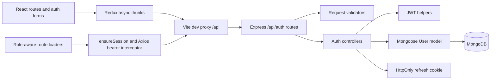

# Jogaar — Role-Based Marketplace

**In active development.** A React and Express marketplace prototype for seekers and service providers. The current implementation focuses on account/session APIs, client session state, role-aware navigation, and the authentication interface. Service listings, search, bookings, and a working provider dashboard are not implemented.

JavaScript · React · Redux Toolkit · React Router · Custom CSS · Node.js · Express · MongoDB · Mongoose · JWT

## Current implementation

| Area | Present in the source | Remaining work |
| --- | --- | --- |
| Accounts | Registration, bcrypt password hashing, login validation, user records | Early-return/error handling, duplicate-email handling, strict role validation |
| Sessions | 15-minute JWT access tokens, seven-day refresh JWTs in HttpOnly cookies, refresh and logout endpoints | Cookie security policy, token-storage/replay hardening, expired-token handling |
| Access control | Bearer-token authentication for `/api/auth/me`; client loaders for seeker/provider routes | Server-enforced role authorization for marketplace resources |
| Interface | Landing page, sign-in/join dialogs, Redux auth state, role-specific navigation, light/dark themes | Provider tools, editable profiles, marketplace workflows |
| Verification | Frontend lint/build scripts | Dedicated auth regression tests, integration tests and CI |

This is a development snapshot, not a completed marketplace or a production-ready authentication service. Source presence does not mean every error case is correct. See [implementation status](docs/STATUS.md) and [known security limitations](docs/SECURITY-NOTES.md).

## Start locally

The inspected environment uses Node.js 24 and npm 11. Run the two packages separately; this folder is not an npm workspace.

1. Install and start a local MongoDB instance, or supply your own development database URI.
2. Prepare the backend:

   ```bash
   cd server
   npm ci
   cp .env.example .env
   ```

   Edit `.env` with a development database URI and two independent, randomly generated JWT secrets. Never commit this file. A local secret can be generated with `node -e "console.log(require('node:crypto').randomBytes(48).toString('hex'))"`; run it separately for each secret.

   ```bash
   npm run dev
   ```

   The API currently listens on **port 3000**, hardcoded in `server/src/server.js`. `npm start` runs the same entry without nodemon. `PORT` is not configurable yet.

3. In a second terminal:

   ```bash
   cd real-client
   npm ci
   npm run dev
   ```

   Open the URL printed by Vite. The development proxy forwards `/api` to `http://localhost:3000`; cookies and browser requests use that same-origin development path.

### Environment

Only the backend reads environment variables:

| Variable | Purpose |
| --- | --- |
| `MONGO_URI` | Development MongoDB connection string |
| `ACCESS_TOKEN_SECRET` | Access-token signing and verification |
| `REFRESH_TOKEN_SECRET` | Refresh-token signing and verification; use a different secret |

The frontend currently has no required `.env` configuration. No public deployment or hosted demo is configured in this source tree. A production host would also need a same-origin `/api` reverse proxy, SPA route fallback, database configuration, and reviewed cookie/security settings.

## Architecture



The client keeps its access token in Redux memory. Sign-in and registration responses set the session; page-entry loaders attempt refresh through the cookie. The Axios instance attaches the current token to `/api/auth/me`. The API validates the access JWT before loading that user. Client role checks help navigation; they do not replace server authorization.

[Architecture and session flow](docs/ARCHITECTURE.md) · [REST API](docs/API.md) · [Feature checklist](docs/STATUS.md)

## Project map

- `real-client/src/actions/authAction.js`: registration, login, refresh and logout thunks.
- `real-client/src/features/auth/authSlice.js`: shared session state and async action handling.
- `real-client/src/guards/`: guest and role-aware route loaders.
- `real-client/src/features/auth/components/`: forms and dialogs.
- `server/src/routes/`, `controller/`, `validator/`, `middleware/`: API flow.
- `server/src/model/user.model.js`: the only database model currently present.
- `server/src/utils/auth.utils.js`: JWT creation and verification.

## Verification

```bash
cd real-client
npm run lint
npm run build
npm run preview
```

The backend has no implemented automated test suite: `npm test` is still the original failing placeholder. Syntax can be checked with `node --check src/server.js` from `server/`; a syntax check is not an API test. End-to-end authentication additionally requires an isolated development MongoDB and both applications. A build alone does not establish successful authentication or authorization.

The publication review records the executed checks and their actual results in [implementation status](docs/STATUS.md). No GitHub Actions workflow is configured yet.

## Contributing and next steps

Start with request/error handling and authentication tests, then implement backend role authorization before exposing role-specific marketplace APIs. Keep changes scoped and keep the status checklist current. Do not use real customer data or credentials in development fixtures.

A repository license has not been selected yet.
